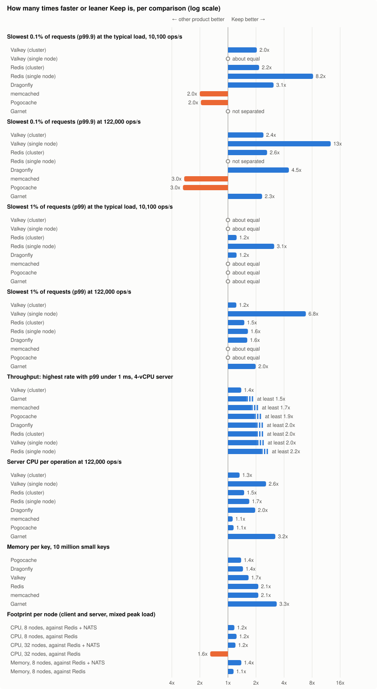
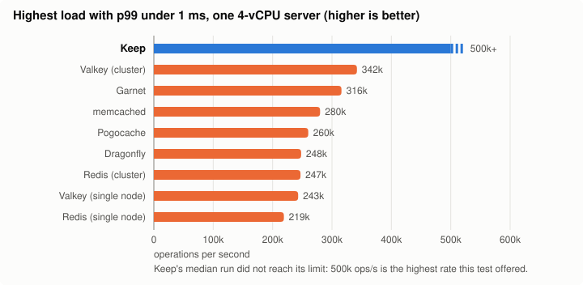
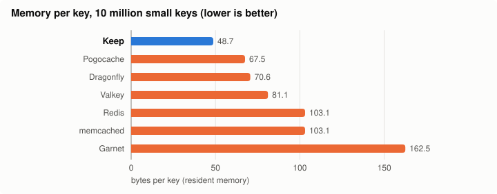

# Keep benchmarks

Stalwart Keep does two jobs a clustered application often needs: a fast in-memory key-value store (locks, rate-limit counters, short-lived tokens) and the event stream that keeps cluster nodes in sync. This page compares Keep with the products people use for those jobs today: Redis, Valkey and Dragonfly for key-value work, Redis or NATS for the events. memcached, Pogocache and Garnet are measured too, as reference points. Every test ran on cloud servers we rented for the purpose, with the same load, the same hardware and the same network for every product. The load is a mail-server cluster workload modelled on Stalwart, one use case for Keep; an application with a different mix of requests should expect different numbers.

## Summary

**How to read "N times faster".** For latency we compare how long the slowest requests take at the same load: if Keep's slowest 0.1% of requests finish within 100 microseconds and another product's within 200, Keep is 2 times faster on that measure. For latency and CPU, each factor is the median of the ratios of repeated paired runs, so it can differ noticeably from the ratio of the two median times shown in the tables, because the slowest requests vary a lot between runs. For throughput we compare the highest load each product sustains while 99% of requests still finish within 1 millisecond. Throughput and memory factors are ratios of the medians. For CPU and memory, "N times leaner" means the other product uses N times as much. "About equal" means the difference is inside the measurement's noise margin (12.5% for the slowest 0.1%, 13% for the slowest 1%, 10% for CPU and throughput). "Not separated" means the repeated runs disagreed too much to call a winner.

Across the 60 headline comparisons, Keep is better in 45, the other product in 5, 8 are about equal, and 2 are not separated by the measurement.

The tally covers key-value latency (the slowest 0.1% and the slowest 1% of requests, at both loads), throughput, CPU, memory and the cluster footprint; the event stream results are in [Event streaming](#event-streaming). The five comparisons Keep loses are listed with their causes in [Cases where another product is better](#cases-where-another-product-is-better).

## Key-value latency

The load is a mix of small key-value requests (counters, locks, lookups and short-lived values), modelled on what a Stalwart mail server cluster sends, at two rates: 10,100 requests per second, the typical load of a large deployment, and 122,000 per second, its peak. Each product ran on the same 4-vCPU server. Cluster products ran as one node per vCPU, single-node products as one process using every vCPU. The client measured every request end to end, network round trip included (about 45 to 60 microseconds on these servers).

The slowest requests matter most in this workload: when a lock or rate-limit check is slow, a whole SMTP or IMAP command waits for it. The tables show the median of 10 paired runs spread over 5 cloud regions.

**The slowest 0.1% of requests (p99.9), lower is better.**

At 10,100 requests per second (typical load):

| Product | Keep | Product | Faster |
|---|---|---|---|
| Valkey (cluster) | 133 us | 357 us | **Keep**, 2.0x |
| Valkey (single node) | 133 us | 148 us | about equal |
| Redis (cluster) | 133 us | 328 us | **Keep**, 2.2x |
| Redis (single node) | 133 us | 1,102 us | **Keep**, 8.2x |
| Dragonfly | 133 us | 522 us | **Keep**, 3.1x |
| memcached | 133 us | 71 us | **memcached**, 2.0x |
| Pogocache | 133 us | 70 us | **Pogocache**, 2.0x |
| Garnet | 133 us | 94 us | not separated |

At 122,000 requests per second (peak load):

| Product | Keep | Product | Faster |
|---|---|---|---|
| Valkey (cluster) | 334 us | 820 us | **Keep**, 2.4x |
| Valkey (single node) | 334 us | 4,089 us | **Keep**, 13x |
| Redis (cluster) | 334 us | 901 us | **Keep**, 2.6x |
| Redis (single node) | 334 us | 386 us | not separated |
| Dragonfly | 334 us | 1,428 us | **Keep**, 4.5x |
| memcached | 334 us | 108 us | **memcached**, 3.0x |
| Pogocache | 334 us | 101 us | **Pogocache**, 3.0x |
| Garnet | 334 us | 796 us | **Keep**, 2.3x |

**The slowest 1% of requests (p99), lower is better.** At the typical load most products are close here, because the network round trip makes up most of the time.

At 10,100 requests per second:

| Product | Keep | Product | Faster |
|---|---|---|---|
| Valkey (cluster) | 59 us | 65 us | about equal |
| Valkey (single node) | 59 us | 64 us | about equal |
| Redis (cluster) | 59 us | 70 us | **Keep**, 1.2x |
| Redis (single node) | 59 us | 170 us | **Keep**, 3.1x |
| Dragonfly | 59 us | 74 us | **Keep**, 1.2x |
| memcached | 59 us | 58 us | about equal |
| Pogocache | 59 us | 58 us | about equal |
| Garnet | 59 us | 64 us | about equal |

At 122,000 requests per second:

| Product | Keep | Product | Faster |
|---|---|---|---|
| Valkey (cluster) | 83 us | 103 us | **Keep**, 1.2x |
| Valkey (single node) | 83 us | 662 us | **Keep**, 6.8x |
| Redis (cluster) | 83 us | 124 us | **Keep**, 1.5x |
| Redis (single node) | 83 us | 148 us | **Keep**, 1.6x |
| Dragonfly | 83 us | 132 us | **Keep**, 1.6x |
| memcached | 83 us | 78 us | about equal |
| Pogocache | 83 us | 80 us | about equal |
| Garnet | 83 us | 170 us | **Keep**, 2.0x |

At the typical load, half of Keep's requests finish in 50 microseconds and 99% within 59. Subtract the network round trip and that leaves 12 microseconds inside the server at the 99th percentile, and 36 microseconds at the peak load.

## Throughput

Keep served 500,000 requests per second, the highest rate this test offered, with 99% of requests still under 1 ms in two of the three runs (the third crossed 1 ms at 490,000), so its median limit is at least 500,000. The table lists each product's best configuration, as the median of three runs. Against Valkey cluster, the strongest competitor, we ran an extra test with more load generators to find Keep's real limit: Keep came out 1.39 times ahead (1.22 to 1.61 across runs).

| Product | Product | Keep | Keep ahead by |
|---|---|---|---|
| Valkey (cluster) | 342k ops/s | 500k+ ops/s | 1.39x |
| Garnet | 316k ops/s | 500k+ ops/s | at least 1.5x |
| memcached | 280k ops/s | 500k+ ops/s | at least 1.7x |
| Pogocache | 260k ops/s | 500k+ ops/s | at least 1.9x |
| Dragonfly | 248k ops/s | 500k+ ops/s | at least 2.0x |
| Redis (cluster) | 247k ops/s | 500k+ ops/s | at least 2.0x |
| Valkey (single node) | 243k ops/s | 500k+ ops/s | at least 2.0x |
| Redis (single node) | 219k ops/s | 500k+ ops/s | at least 2.2x |

## CPU per request

Server CPU time per request, measured at 122,000 requests per second. Lower CPU per request leaves more of the machine to the application and costs less to run.

| Product | Keep uses | Less CPU |
|---|---|---|
| Valkey (cluster) | 0.75 of its CPU per op | **Keep**, 1.3x |
| Valkey (single node) | 0.39 of its CPU per op | **Keep**, 2.6x |
| Redis (cluster) | 0.67 of its CPU per op | **Keep**, 1.5x |
| Redis (single node) | 0.59 of its CPU per op | **Keep**, 1.7x |
| Dragonfly | 0.51 of its CPU per op | **Keep**, 2.0x |
| memcached | 0.89 of its CPU per op | **Keep**, 1.1x |
| Pogocache | 0.87 of its CPU per op | **Keep**, 1.1x |
| Garnet | 0.31 of its CPU per op | **Keep**, 3.2x |

## Memory per key

Each product was loaded with 10 million small keys (13-byte keys, 8-byte values), and its memory use was read after the load settled, minus its memory when empty.

| Product | Bytes per key | Keep uses less |
|---|---|---|
| Keep | 48.7 |  |
| Pogocache | 67.5 | 1.4x |
| Dragonfly | 70.6 | 1.4x |
| Valkey | 81.1 | 1.7x |
| Redis | 103.1 | 2.1x |
| memcached | 103.1 | 2.1x |
| Garnet | 162.5 | 3.3x |

With the workload's mix of key sizes instead of uniform small keys, Keep uses 84 bytes per key: 15 to 25% less than Redis, Valkey and Dragonfly, and level with Pogocache.

## Footprint in a mail-server cluster

Here Keep does both jobs at once. We simulated a mail-server cluster modelled on Stalwart (8 and 32 nodes, each running Keep's client) under its peak mixed workload: key-value requests plus the cluster events every node has to see. Keep was compared with Redis doing both jobs, and with Redis for key-value plus NATS for events. The CPU figure is per simulated node and counts both the server and the client library.

| Setup | Compared with | Keep uses | Better |
|---|---|---|---|
| 8 nodes, CPU | Redis | 0.81 of its CPU | **Keep**, 1.2x |
| 8 nodes, CPU | Redis + NATS | 0.85 | **Keep**, 1.2x |
| 8 nodes, memory | Redis | 0.87 of its memory | **Keep**, 1.1x |
| 8 nodes, memory | Redis + NATS | 0.72 | **Keep**, 1.4x |
| 32 nodes, CPU | Redis + NATS | 0.83 | **Keep**, 1.2x |
| 32 nodes, CPU | Redis | 1.55 | **Redis**, 1.6x |

An idle Keep server uses about 3 milliseconds of CPU per second.

## TLS

Turning on TLS 1.3 costs Keep 4 to 10% of its throughput. At the typical and peak loads it adds 3 to 6% to the slowest 1% of requests.

## ARM servers

The key-value latency and CPU comparisons and the event stream against NATS were repeated on ARM servers (Azure Cobalt 100, the same vCPU counts as on x86).

| Test | Compared with | Keep | Better |
|---|---|---|---|
| Key-value p99, 10,100 requests/s | Valkey cluster | 0.70 of its time | **Keep**, 1.4x |
| Key-value p99, 122,000 requests/s | Valkey cluster | 0.76 | **Keep**, 1.3x |
| Server CPU per request, 122,000 requests/s | Valkey cluster | 0.41 | **Keep**, 2.4x |
| Event p99, 3 nodes x 104 events/s | NATS | 0.78 | **Keep**, 1.3x |
| Event p99, 8 nodes x 104 and 1,558 events/s | NATS | 0.82 to 1.00 | about equal |

Keep's event broker uses less CPU than NATS in every ARM event test. On throughput, both Keep and Valkey cluster stayed under 1 ms up to the highest rate the ARM test offered (500,000 requests per second), so the ARM run does not rank them. At 8 nodes x 1,558 events per second, Keep's slowest 1% of deliveries take 490 microseconds on ARM, against 515 for NATS.

## Event streaming

In the mail-server workload every node publishes cluster events (such as cache invalidations), and every node has to receive all of them. Simulated nodes published at 104, 1,558 and 15,580 events per second per node to one broker server, and every node subscribed. Keep ran with its default settings. At 32 nodes it was compared with NATS, Kafka, Valkey, Dragonfly and Fluvio; at 3 and 8 nodes, with NATS. Latency is the time from publish to delivery at a subscriber. Each test ran twice: on the kernel's default TCP settings, and with the 5 ms minimum retransmission timeout the deployment guide recommends (in parentheses).

| Setup | Compared with | Keep | Better |
|---|---|---|---|
| 32 nodes x 104 events/s, p99 | Dragonfly, the next best (NATS with the 5 ms timeout) | 0.60 of its time (0.64) | **Keep**, 1.7x |
| 32 nodes x 1,558 events/s, p99 | Dragonfly, the next best | 0.63 (0.73) | **Keep**, 1.6x |
| 32 nodes x 104 events/s, broker CPU per event | Dragonfly, the next best | 0.67 (0.71) | **Keep**, 1.5x |
| 32 nodes x 1,558 events/s, broker CPU per event | Kafka, the next best | 0.66 (0.67) | **Keep**, 1.5x |
| 3 nodes x 104 events/s, p99 | NATS | 0.92 (0.96) | about equal |
| 8 nodes x 104 events/s, p99 | NATS | 0.92 (0.88) | about equal |
| 8 nodes x 1,558 events/s, p99 | NATS | 0.92 (0.89) | about equal |
| 3 nodes x 15,580 events/s, p99 | NATS | 1.02 (1.00) | about equal |
| 3 and 8 nodes, broker CPU per event | NATS | 0.71 to 0.86 (0.70 to 0.85) | **Keep**, up to 1.4x |

At 32 nodes Keep delivers 99% of events within 169 microseconds at 104 events per second per node and within 287 at 1,558 (99.9% within 186 and 319). Valkey's PUBLISH costs 10 times Keep's CPU per event at 32 nodes x 104.

In the simulated cluster (see [Footprint in a mail-server cluster](#footprint-in-a-mail-server-cluster)), Keep's event latency is no worse than Redis plus NATS in any workload phase at 8 and 32 nodes.

## Cases where another product is better

Keep does not win every comparison. These are the cases where it loses or where the result is level:

- **memcached and Pogocache** are 2.0x faster than Keep on the slowest 0.1% of requests at the typical load, and 3.0x at the peak load, on a 4-vCPU server. The slowest 1% are level. On a 16-vCPU server the gap shrinks to 1.07 to 1.21. They are measured as reference points; for this workload, Keep does the job of Redis or Valkey together with an event broker. The most likely cause is a rare delay inside Keep's server on small machines: a request occasionally waits while the network card's receive work runs on the same CPU core, or while that core wakes from idle.
- **Redis at 32 nodes**: Redis uses 1.6x less CPU per node than Keep when it does both jobs for a 32-node cluster. At that size every cluster event goes to 32 nodes, and Keep sends fewer events per network write than Redis does. Against Redis + NATS, the pair that does the same two jobs, Keep still uses less (0.83). At 8 nodes Keep uses less CPU than both.
- **Event fan-out CPU on ARM**: on Cobalt 100, Valkey's broker uses 1.36x to 2.14x less CPU per event than Keep at 3 nodes (104 and 1,558 events/s) and 8 nodes (104 events/s). At 8 nodes x 1,558 events/s with the 5 ms minimum retransmission timeout, Dragonfly's slowest 1% of deliveries are 1.23x faster than Keep's.
- **Level results**: Valkey single node on the slowest 0.1% at the typical load is about equal. Garnet at the typical load and Redis single node at the peak load are not separated by the measurement.

## Things to keep in mind

- **Same conditions for everyone.** Every product ran on the same servers, one at a time in a random order, repeated several times across regions. Each latency and CPU comparison is the median of the paired ratios, with a 95% confidence interval.
- **Network included.** Latency is what a client sees, round trip included, which is how an application sees it too.
- **Best configuration per product.** Valkey was measured as a cluster and as a single node, each in two key layouts: its own recommended one and the one Stalwart uses. Redis was measured as a cluster with Stalwart's layout and as a single node with its own. Each table shows Valkey's better layout for that measure, so Valkey single node uses its own layout in the latency and CPU tables and Stalwart's in the throughput table.
- **Encryption off for the comparison.** All products ran without TLS in the latency and throughput tests; Keep's TLS cost is measured separately above.
- **CPU accounting.** CPU per request counts the CPU time of each product's server process. Network processing that the kernel does outside that process is not counted for any product.
- **Event CPU at small clusters.** At 3 and 8 nodes on x86, Keep's broker CPU per event was compared with NATS only (Keep uses 0.70 to 0.86 of NATS's), not with Valkey. On ARM, Valkey's PUBLISH fan-out uses less CPU per event than Keep at those sizes (see [Cases where another product is better](#cases-where-another-product-is-better)).
- **Synthetic load.** The requests are modelled on Stalwart's key-value patterns, but they come from a load generator, not from live mail traffic.
- **Cloud servers.** Results come from Azure VMs (AMD EPYC, F-series v7), with the CPU set to stay awake between requests (`idle=poll`) in the key-value latency and event stream tests, for every product alike. The memory and footprint tests, and every ARM test, used the default setting.
- **Retransmission timeout.** The x86 key-value latency tests ran with the 5 ms minimum TCP retransmission timeout the deployment guide recommends, on every server and for every product. The ARM key-value latency results use the same setting.

## Test method

- **Hardware.** Server: Azure Standard_F4as_v7 (4 vCPU) for latency, throughput and CPU; Standard_F16as_v7 (64 GiB) for memory. Load generators: two or three Standard_F16as_v7, in the same placement group, with round trips of about 45 to 60 microseconds. ARM: Standard_D4ps_v6 and D16ps_v6 (Cobalt 100).
- **Software.** Keep 1.0, built for the baseline x86-64 level; the release binaries target x86-64-v2. Valkey 9.1.2, Redis 8.10.2, Dragonfly 2.0.2, Garnet 2.2.3, Pogocache 1.3.2, memcached 1.6.45, NATS 2.15.1, Kafka 4.3.1, Fluvio 0.18.1, all from their official container images, on Debian 13 (Linux 6.12).
- **Latency.** 5 regions, 2 repetitions in each. In every repetition each product runs at each rate once, in a seeded random order. Rates: 10,100 and 122,000 requests per second, plus 80% of each product's own throughput limit. 32 client connections per server vCPU for every product.
- **Throughput.** The offered rate grows step by step. A product's result is the rate at which its 99th percentile crosses 1 ms. Three repetitions; the comparison with Valkey cluster ran three more with three load generators.
- **Memory.** Each product starts fresh, is loaded with 10 million keys and settles for 30 s, and then its resident memory is read. Every key is read back to confirm that it is still there. Three repetitions.
- **Cluster footprint.** Simulated nodes on separate servers, each running the real Keep client or the Redis and NATS clients, with the workload phases of a mail cluster (mail delivery, IMAP sessions, web sessions, and the mixed peak).
- **Event streaming.** One broker server (Standard_F16as_v7) and two load-generator servers carrying the simulated nodes, each node publishing and subscribing. Rates per node: 104 and 15,580 events per second at 3 nodes, 104 and 1,558 at 8 and at 32 nodes. Each result is the median over 3 to 5 paired repetitions.

## Reproduce

The scripts that run these benchmarks against every product are in [`harness/`](../harness/README.md), with a short smoke test for each harness. The table and analysis scripts are there too.
